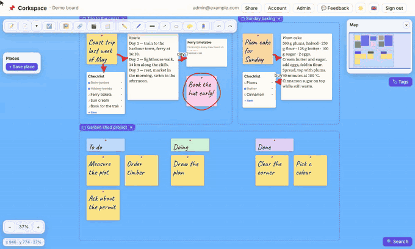
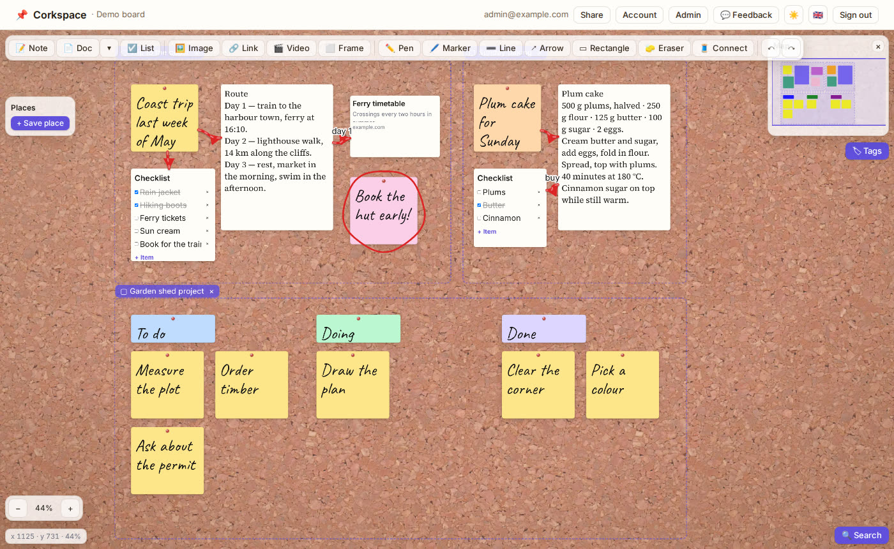
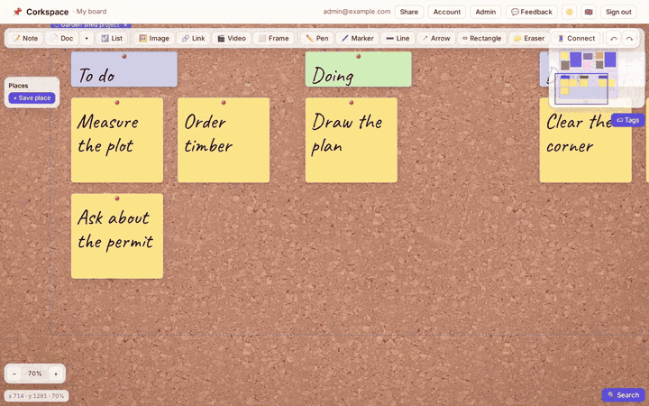
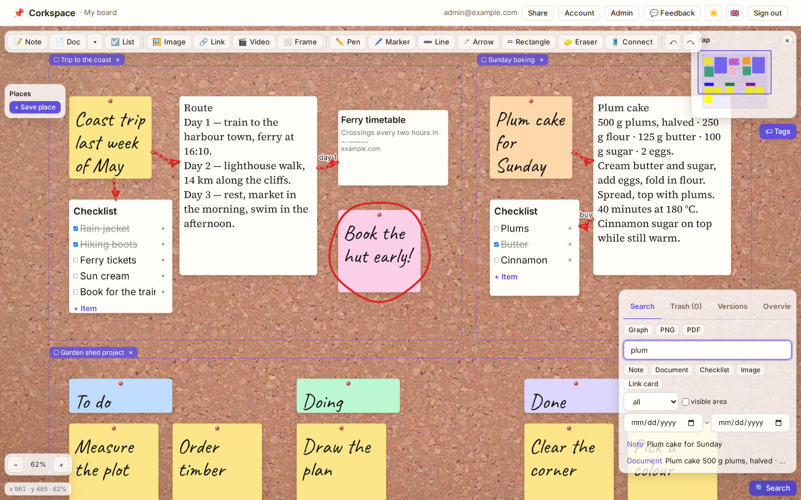
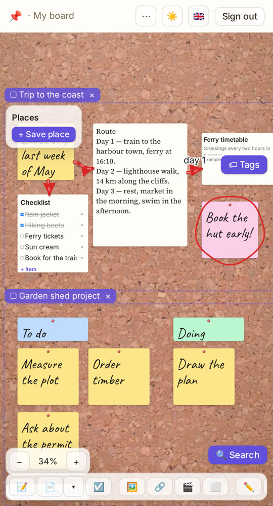
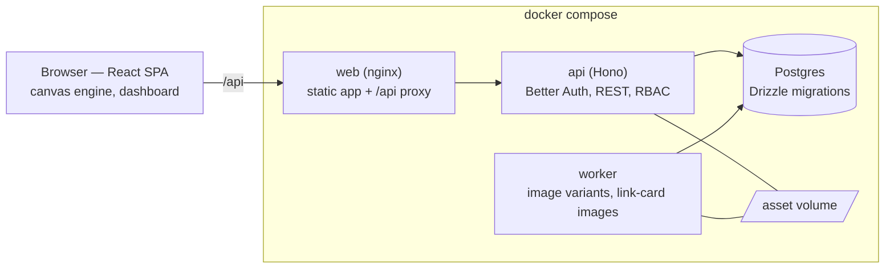

# Corkspace

**Your own infinite pinboard: notes, documents, checklists, images and links on one canvas, tied
together with red threads — self-hosted, and everything stays findable.**



- **An infinite canvas that stays smooth** — a custom engine (no canvas SDK) with culling and level
  of detail; zoom from 2 % to 800 % across thousands of items.
- **More than sticky notes** — rich documents, checklists, images, link cards and YouTube/Vimeo
  embeds sit on the board next to notes in six colours.
- **Connect the dots** — red threads with labels, freehand drawing, frames that move their contents,
  teleports to saved places, tags.
- **Find it again** — full-text search that flies you to the result, 20 versions per entry, trash,
  a connection graph, PNG/PDF export.
- **Runs on your server** — Docker Compose and Postgres, accounts you create, editor/viewer sharing
  and read-only links, MIT licence.

## Quick start

You need Docker with the Compose plugin.

```bash
git clone https://github.com/Juice-de-Orange/corkspace.git && cd corkspace
./setup              # writes infra/.env with generated secrets, prints your admin sign-in
docker compose up -d
```

Open <http://localhost:8080> and sign in with the address and password `./setup` printed.
`docker compose up -d` pulls the release images `ghcr.io/juice-de-orange/corkspace-{api,worker,web}`
(amd64 and arm64, published from v0.1.0 on); if it cannot pull them, it prints "denied" warnings
and builds them from this checkout instead. With the release images pulled and `postgres:16-alpine`
already cached, the sign-in page was up **about 1½ minutes** after `git clone` (measured
2026-10-12 in two runs: 82 s and 101 s). Building from source takes longer: 140 s on a clean
Docker host (8 CPU cores, no cached images).

To see a filled board right away, add the synthetic demo board from the GIF to your (empty) board:
`docker compose --profile demo run --rm seed`. There is no public sign-up — you create further
accounts under **Admin → Users**. For a server behind a TLS reverse proxy (`./setup
https://corkspace.example.com` writes the right addresses), backups and upgrades, see
[docs/DEPLOYMENT.md](docs/DEPLOYMENT.md).

[](https://github.com/Juice-de-Orange/corkspace/actions/workflows/ci.yml)
[](LICENSE)

Built with AI assistance.

## How it compares

Checked against each project's own website, docs and licence on 2026-10-12. Corkspace is a small,
young project; the others are mature products with large communities.

| | Corkspace | [Miro](https://miro.com) | [tldraw](https://tldraw.dev) | [Excalidraw](https://excalidraw.com) | [AFFiNE](https://affine.pro) |
|---|---|---|---|---|---|
| What it is | Self-hosted pinboard app | Hosted whiteboard (SaaS) | Whiteboard SDK, plus the tldraw.com app | Hand-drawn style whiteboard | Docs, whiteboard and databases in one workspace |
| Licence | MIT | Proprietary | tldraw license: production use needs a licence key (trial, hobby with watermark, or commercial) | MIT | Mixed: MIT / MPL-2.0, server parts under an Enterprise licence |
| Self-hosting | Docker Compose (web, api, worker, Postgres) | No | Inside your own app; you host the sync server | Official Docker image of the editor; "self-hosting your own instance doesn't support sharing or collaboration features" | Official Docker Compose (with Postgres and Redis); free self-hosted tier up to 10 members per workspace |
| Real-time co-editing | **No** — last write wins, others' changes appear on reload | Yes | Yes (tldraw sync) | Yes on excalidraw.com, end-to-end encrypted | Yes |
| Accounts and sharing when self-hosted | Accounts created by an admin; editors and viewers per board; read-only links; per-entry public/private | — | You build them | None in the self-hosted editor | Workspaces with members |
| Offline | No | No official offline mode found | Saves to the browser (IndexedDB) | Local-first, works offline | Local-first, desktop app |
| Apps | Web, with a touch UI for phones | Web, desktop, iOS, Android | SDK for your own app | Web (PWA) | Web, desktop |

**Where they are better:** Miro has real-time collaboration, thousands of templates, hundreds of
integrations and native apps. tldraw is a polished canvas engine and multiplayer SDK to build your
own product on. Excalidraw is the quickest way to sketch together, end-to-end encrypted, with a
huge community. AFFiNE combines documents, databases and a whiteboard, works local-first and has
real-time sync. All four are far more mature than Corkspace.

**Where Corkspace fits:** you want one private board per person on your own server, where
documents, checklists, images and links live on the canvas next to the notes, connected by threads,
searchable and versioned, under MIT — and you do not need live co-editing.

## Features



- **A truly infinite board.** Pan, pinch and zoom from 2 % to 800 %; the camera never
  re-renders React, a spatial index culls everything off-screen, and items switch to lighter
  representations as they get small on screen. Minimap, position readout, and the board
  remembers where you were.
- **Entries:** sticky notes in six colours, rich documents (TipTap: headings, lists, quotes,
  code blocks, links, `==highlight==`, lined or grid paper), checklists, images (incl. animated
  GIFs) and link cards (with a fetched title, description and image when an administrator adds
  them, see [Known limitations](#known-limitations)); YouTube and Vimeo embeds in sandboxed frames.
- **Red threads** between entries with labels and arrowheads, **freehand drawing** (pen,
  marker, lines, arrows, rectangles, eraser) on entries and the board, **frames** that move
  their contents, **teleports** to bookmark places, **tags** with styling rules.
- **Find anything:** a dashboard with full-text search, filters, a connection graph, orphans,
  trash and version history (20 versions per entry) — and a jump-to flight to any result.
- **Sharing:** invite registered users as editors or viewers, or create no-account read
  links. Viewers only ever receive entries marked public — enforced in the database query,
  not in the UI.
- **Comfort:** autosave, undo/redo for every change, light / dark / retro themes, per-board
  appearance (cork, paper, linen or bright backgrounds; fonts; sizes), export of the current
  view as PNG or PDF, and a full touch UI for phones.
- **English and German UI**, English by default.



<table>
<tr>
<td></td>
<td></td>
</tr>
</table>

## How it is built



```
apps/web         React 19 + Vite + Tailwind (canvas, dashboard, admin)
apps/api         Hono + Better Auth + Drizzle REST API
apps/worker      sharp image variants and background jobs
packages/engine  pure canvas math: coordinates, camera, culling, LOD, collision, routing, flight
packages/db      Drizzle schema + migrations (each with a tested down migration)
packages/shared  domain kernel, Zod DTOs, SSRF-guarded fetching, pure domain logic
infra            docker-compose, Dockerfiles, nginx
```

The decisions behind the canvas engine, the data model and the security rules are in
[docs/DESIGN.md](docs/DESIGN.md) and the [architecture decision records](docs/adr/). A public
try-it-yourself instance (guest boards, hourly reset) runs with `DEMO_MODE=on`, see
[docs/demo.md](docs/demo.md).

## Development

Node ≥ 22 and pnpm 11 (`corepack enable`). Integration and end-to-end tests start Postgres in
Docker through testcontainers.

```bash
pnpm install
pnpm --filter @corkspace/api dev   # API with reload (needs a Postgres in DATABASE_URL)
pnpm --filter @corkspace/web dev   # web app on Vite, proxies /api
pnpm verify              # focused-test guard, biome, knip, typecheck, unit, integration, build
pnpm verify:full         # verify + security audit + e2e (Playwright, desktop + mobile) + perf
```

The test layers, coverage gates (engine/shared ≥ 90 %, api ≥ 85 %) and conventions are described
in [docs/TESTING.md](docs/TESTING.md). Contributions are welcome — start with
[CONTRIBUTING.md](CONTRIBUTING.md).

## Status

Built in June and July 2026 and in use on a small self-hosted instance since. The feature set
above is complete and covered by the test suites; open ideas and known rough edges are in the
[issues](https://github.com/Juice-de-Orange/corkspace/issues).

The release was checked by hand from a fresh clone against the compose stack, but only at
`http://localhost` and in Chromium: operation behind a TLS reverse proxy, other browsers and the
upgrade procedure in [docs/DEPLOYMENT.md](docs/DEPLOYMENT.md) were not part of those checks.

## Known limitations

- **No e-mail.** Corkspace sends no mail; the `SMTP_*` variables are reserved and unused (#10).
  What that means in practice:
  - *Forgotten password:* there is no self-service reset, and users cannot change their own
    password. An administrator sets a new one under **Admin → Users → (user) → New password** and
    passes it on. If the only administrator is locked out, see
    [DEPLOYMENT.md §4](docs/DEPLOYMENT.md#4-first-administrator) (a second admin account from
    `ADMIN_EMAIL`).
  - *New accounts:* the administrator chooses the initial password and hands it over outside the
    app; nobody is told that an account exists.
  - *Board invitations:* an owner can only invite people who already have an account; they are not
    notified, the board simply appears in their board switcher.
  - *Feedback:* new feedback is not announced; administrators look under **Admin → Feedback**.
- **No real-time collaboration.** Two people editing the same board work last-write-wins per
  entry; changes by others appear on reload.
- **Link previews only for administrators.** Fetching a page's title, description and image for a
  link card is limited to the instance administrator; for everyone else the card shows the plain
  link.
- Touch e2e tests are not automated yet (#11); the release checks ran in Chromium only, see
  [Status](#status).

## AI assistance

As said at the top: built with AI assistance. The working method — phased plans with hard quality gates (tests, coverage, audits) — is
described in [CLAUDE.md](CLAUDE.md).

## License

[MIT](LICENSE) © 2026 Max Oberrauch. Third-party assets: see [THIRD_PARTY.md](THIRD_PARTY.md).
